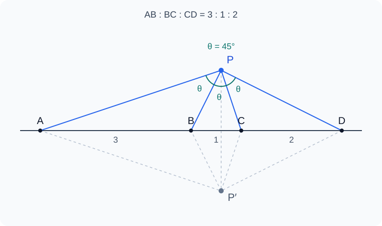

# Euclid-Equal-Angle-Min

**Shortest straightedge-and-compass constructions for four collinear points with equal viewing angles** · [简体中文](README.md)

Given four distinct points A, B, C, D in that order on a line, construct an off-line point P such that

$$
\angle APB=\angle BPC=\angle CPD.
$$

This project studies existence and the fewest elementary drawing moves needed, for either one solution in a specified half-plane or both mirror solutions.



## Results

Write AB=a, BC=b, CD=c, with positive lengths. Solutions exist exactly when

$$
\Delta=3ac-b(a+b+c)>0,
$$

equivalently $(a+b)(b+c)<4ac$. There is then exactly one solution in each half-plane.

As of **2026-11-09**:

| Result | Scope and evidence |
|---|---|
| **9 E upper bound** | Covers every solvable input and constructs both solutions. The main branch draws four lines and five circles. [Construction and proof](docs/NINE.md) |
| **6 E generic lower bound** | A function-field argument and exact finite enumeration exclude all programs of at most five draws on generic inputs. [Computer-assisted proof](docs/LOWER_BOUND.md) |
| 10 E original baseline | Exactly replayed, but subject to additional length restrictions. [Audit](docs/BASELINE.md) |
| 7 E / 2 E special families | Seven moves for certain equal-length families; exactly two moves on two specified product-condition families. [Conditions and proofs](docs/REFINEMENTS.md) |

**The generic optimum and the optimum worst-case cost over all solvable inputs are currently bounded by 6–9 E.** The next goal is a general eight-move construction. Nine-move minimality is open; the generic lower bound does not apply to every special input.

The research priority is full-domain coverage and worst-case branch cost. Failure of an auxiliary construction must be handled by another branch when the original problem remains solvable.

## Move model

The four points and their complete line are free inputs.

- A line through two existing distinct points: **1 E**.
- A circle centered at an existing point through another existing point: **1 E**.
- All finite real intersections of existing objects: **0 E**.

Use an unmarked straightedge and a collapsible compass. Arbitrary auxiliary points and free radius transfer are unavailable. Midpoints, perpendiculars and parallels must be expanded into elementary draws. Repeated draws, branch tests requiring geometry, and failed attempts count.

Track `EA-ONE` and `EA-ALL` separately, with generic (`gen`) and full-domain (`rob`) coverage. See [DESIGN](docs/DESIGN.md).

## Reproduce

Requirements: **Git, Docker and PowerShell 7**. Reports were generated with **SageMath 10.7**; numeric screens also use NumPy.

```powershell
git clone https://github.com/lenovobenben/euclid-equal-angle-min.git
cd euclid-equal-angle-min

# Skip if a container named sage is already running.
docker run -d --name sage sagemath/sagemath:latest sleep infinity

pwsh -NoProfile -File experiments/verify-nine.ps1
pwsh -NoProfile -File experiments/verify-refined.ps1
pwsh -NoProfile -File experiments/verify-lower-bound.ps1
```

Scripts copy their dependencies into the running container and write reports to `experiments/results/`. Use `-Container` to select another container. The `latest` image can change; check the SageMath version in each report.

The nine-move verifier checks 14 identities and 21 classified replay fixtures. The refinement verifier checks 10 further identities, 29 fixtures and all 19 regression tests. The lower-bound verifier checks 192 seed configurations, 3,600 field conditions, 1,680 center conditions and 840 denominator-unit conditions.

Finite fixtures do not replace domain proofs. Floating screens discover candidates; exact replay, symbolic identities and branch coverage certify constructions. Search failures alone do not prove lower bounds.

## Read the research

Detailed proofs are in Chinese:

- [Existence and uniqueness](docs/EXISTENCE.md), [problem statements](docs/PROBLEMS.md).
- [Nine-move construction](docs/NINE.md), [six-move lower bound](docs/LOWER_BOUND.md).
- [Special families](docs/REFINEMENTS.md), [original construction](docs/BASELINE.md).
- [Inversions, a third target locus and Möbius fixed points](docs/PROJECTIVITY.md).
- [Research log](docs/RESEARCH_LOG.md), [bounded search records](docs/SEARCH_LOG.md), [roadmap](docs/ROADMAP.md).
- [Sources and literature](docs/LITERATURE.md).

`docs/` holds proofs and research records; `sources/` preserves original snapshots; `experiments/` contains symbolic verification, exact replays and numeric screens; `tests/` contains regression tests. `animations/` is reserved for future presentation work.

## Construction optimization series

This is the third project in the series:

1. [Euclid-Min](https://github.com/lenovobenben/euclid-min): the regular 17-gon.
2. [Euclid-CCC-Min](https://github.com/lenovobenben/euclid-ccc-min): the Apollonius three-circle problem.
3. [Euclid-Equal-Angle-Min](https://github.com/lenovobenben/euclid-equal-angle-min): four collinear points with equal viewing angles.

The problem also appears as Problem 9 of the 1994 Austrian–Polish Mathematical Competition. No claim of a literature minimum or world record is made.

## License

Original code: [Apache 2.0](LICENSE). Original documentation and research data: [CC BY 4.0](LICENSE-CONTENT). Archived source material retains its source rights; see [license scope](LICENSE-SCOPE.md).
