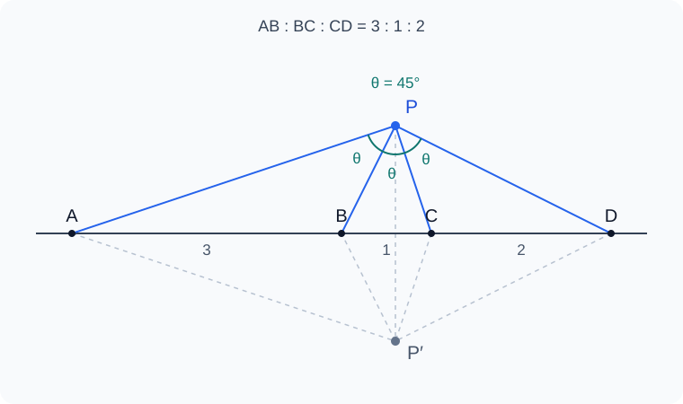

# Euclid-Equal-Angle-Min

**共线四点等视角的最短尺规构造** · [English](README.en.md)

给定一条直线上依次排列的四点 A、B、C、D，在指定一侧作点 P，使

$$
\angle APB=\angle BPC=\angle CPD.
$$

本项目研究两个问题：**什么时候有解？在所有有解输入上，最少需要多少次画线、画圆？** 同时区分构造一个解与构造全部两个镜像解。



图为 AB=3、BC=1、CD=2 的实例；两个解关于输入直线对称。示意图不计入构造步骤。

## 当前结果

设 AB=a、BC=b、CD=c，其中 a,b,c>0。**有解的充要条件**是

$$
\Delta=3ac-b(a+b+c)>0,
$$

等价于 $(a+b)(b+c)<4ac$。有解时，每侧恰有一个解。

截至 **2026-11-09**：

| 结果 | 范围与证据 |
|---|---|
| **9 E 通用上界** | 覆盖全部有解输入，同时得到两个解；一般分支为 4 线 + 5 圆。[步骤与覆盖证明](docs/NINE.md) |
| **6 E 一般下界** | 通过完整短程序分类及精确符号枚举，排除至多五笔的一般构造。[计算机辅助证明](docs/LOWER_BOUND.md) |
| 10 E 历史基线 | 原作图经精确重放验证，但需要额外长度条件。[原作图审计](docs/BASELINE.md) |
| 7 E / 2 E 特殊族 | 部分等长条件有七笔作法；两个明确乘积条件族恰好只需两笔。[条件与证明](docs/REFINEMENTS.md) |

**一般最优值与全域最坏最优值，目前都在 6–9 E 之间。下一目标是覆盖全部有解输入的 8 E 构造。** 尚未证明九笔最短；六笔下界不适用于每个特殊比例输入。

研究优先考虑所有分支与最坏成本。存在条件不满足时无解；某种辅助作图的比例条件不满足时，需要调整构造，不能据此缩小题目的有解域。

## 一步怎样计数

免费输入为四个点及它们所在的完整直线。采用无刻度直尺与塌圆规：

| 操作 | 成本 |
|---|---:|
| 经过两个已有不同点画一条完整直线 | 1 E |
| 以已有点为圆心、经过另一已有点画圆 | 1 E |
| 取得已有线、圆的全部有限实交点 | 0 E |

不任取辅助点，不免费搬运半径。中点、垂线、平行线等操作都要展开计费。重复落笔、分支判断新增的对象和失败尝试也计入成本。

分别记录指定半平面的单解目标 `EA-ONE` 与全部解目标 `EA-ALL`，以及一般位置 `gen` 和全部有解域 `rob`。完整定义见 [研究设计与计分模型](docs/DESIGN.md)。

## 九笔构造的关键

原作图用四只起始辅助圆分别求两条等角轨迹的圆心。新作法复用左侧割线与已有圆的第二交点 T，免费获得一个平行方向，从而省去右侧的一只辅助圆。

必要时反向标号，使较长外段位于左侧。存在条件保证左侧模块合法；右侧通过已证明的分支处理相等间距，最终覆盖全部有解输入。完整九笔动作表、分支和证明见 [NINE](docs/NINE.md)。

另有 [反演、第三条轨迹与射影固定点分析](docs/PROJECTIVITY.md)，作为继续省步的研究入口。

## 复现验证

需要 **Git、Docker 和 PowerShell 7**。精确验证使用容器内的 SageMath；当前报告在 SageMath **10.7** 上生成，数值筛查使用 NumPy。

```powershell
git clone https://github.com/lenovobenben/euclid-equal-angle-min.git
cd euclid-equal-angle-min

# 如果已经有名为 sage 的运行中容器，跳过这一行。
docker run -d --name sage sagemath/sagemath:latest sleep infinity

# 九笔通用构造：符号恒等式、精确交点重放与回归测试。
pwsh -NoProfile -File experiments/verify-nine.ps1

# 七笔 / 两笔条件族及全部 19 项回归测试。
pwsh -NoProfile -File experiments/verify-refined.ps1

# 六笔一般下界的有限精确符号检查。
pwsh -NoProfile -File experiments/verify-lower-bound.ps1
```

验证脚本会复制依赖到容器并把报告写回 `experiments/results/`；通过 `-Container` 可指定其他已运行的容器名称。`latest` 镜像可能随时间更新，复现时应核对报告中的 SageMath 版本。

已有证据包括：

- **存在性**：8 项恒等式、3375 组整数夹具。
- **九笔上界**：14 项恒等式、21 个分类夹具的精确重放。
- **条件族**：10 项恒等式、29 个分类夹具及 19 项回归测试。
- **一般下界**：192 种种子、3600 项平方根域检查、1680 项圆心条件、840 项分母单位检查。

固定样本不是全域覆盖证明。浮点筛查只负责发现候选；一般参数证明、精确重放和分支覆盖分别负责认证。搜索未命中也不自动成为下界。

## 阅读与目录

| 内容 | 入口 |
|---|---|
| 两问与完整存在性证明 | [PROBLEMS](docs/PROBLEMS.md)、[EXISTENCE](docs/EXISTENCE.md) |
| 输入、工具、计费及覆盖口径 | [DESIGN](docs/DESIGN.md) |
| 九笔通用构造 | [NINE](docs/NINE.md) |
| 六笔一般下界 | [LOWER_BOUND](docs/LOWER_BOUND.md) |
| 特殊条件族 | [REFINEMENTS](docs/REFINEMENTS.md) |
| 反演与射影变换 | [PROJECTIVITY](docs/PROJECTIVITY.md) |
| 研究进展、搜索范围与下一方向 | [RESEARCH_LOG](docs/RESEARCH_LOG.md)、[SEARCH_LOG](docs/SEARCH_LOG.md)、[ROADMAP](docs/ROADMAP.md) |
| 来源与原始问答 | [LITERATURE](docs/LITERATURE.md)、[sources](sources/README.md) |

```text
docs/                 题目、证明、计分模型与研究记录
sources/              两篇原始问答快照与来源清单
experiments/          符号验证、精确重放与有界搜索
experiments/results/  验证报告、交点依赖和 E 台账
tests/                回归测试与搜索阳性校准
animations/           预留的几何导出与动画目录
```

## 尺规作图优化系列

这是该系列的第三个项目，结构与验证方法参照 Euclid-CCC-Min。各项目分别定义输入和目标。

1. [Euclid-Min](https://github.com/lenovobenben/euclid-min)：正十七边形。
2. [Euclid-CCC-Min](https://github.com/lenovobenben/euclid-ccc-min)：阿波罗尼乌斯三圆相切问题。
3. [Euclid-Equal-Angle-Min](https://github.com/lenovobenben/euclid-equal-angle-min)：共线四点等视角。

本题也见于 1994 年奥地利—波兰数学竞赛第 9 题，出处见 [LITERATURE](docs/LITERATURE.md)。当前结果不声称文献最短或世界纪录。

## 许可

原创代码采用 [Apache 2.0](LICENSE)，原创文档与研究数据采用 [CC BY 4.0](LICENSE-CONTENT)。归档来源材料保留其原有权利与许可，详见 [许可范围](LICENSE-SCOPE.md)。
